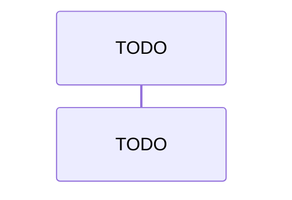

# 关键数据流

> 3-5 条主线流程的时序描述：触发 → 各环节 → 落点，含错误分支。TODO 补一句导读。

## 为什么

哪些流程是系统命脉、为何单独成文（一致性/性能/对账的关键路径）：TODO
漏写的主线流程会在复原时直接缺失——对照 30-features 规格逐条核对覆盖：TODO

## 是什么

流程清单与各自涉及的模块边界：TODO

## 怎么运转

逐条流程的时序与错误分支：TODO
每条流程注明：触发方、参与模块、数据落点、失败时的降级行为
